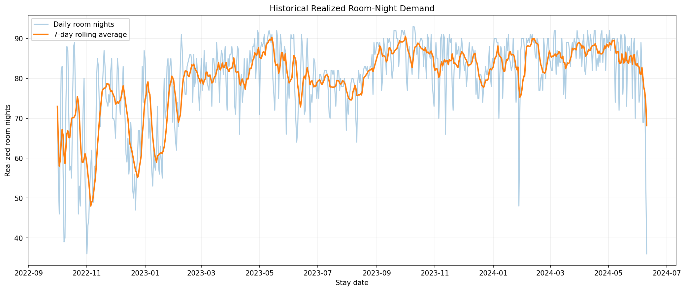
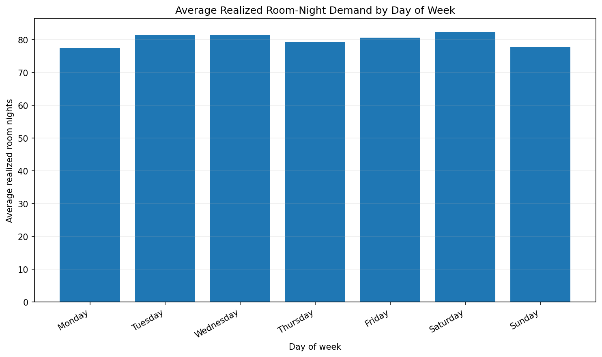
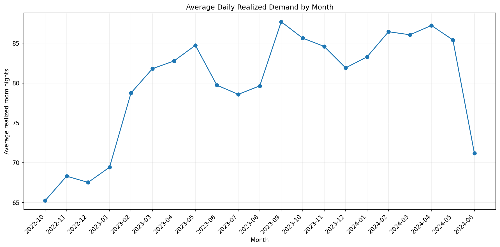
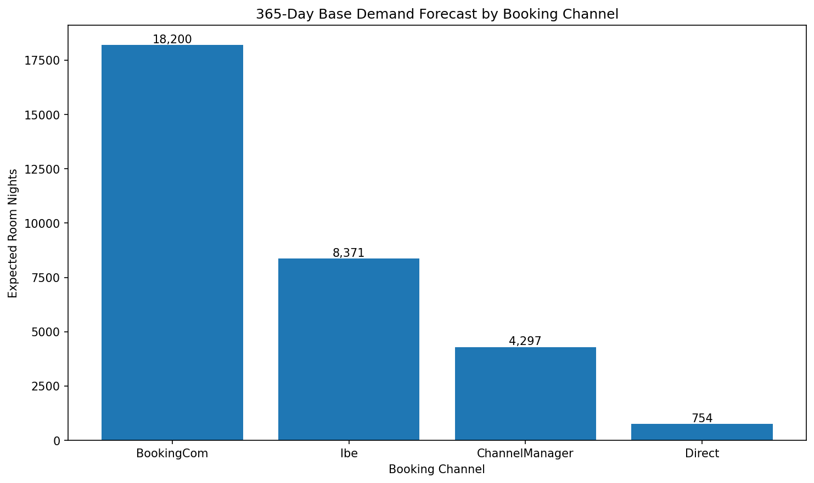
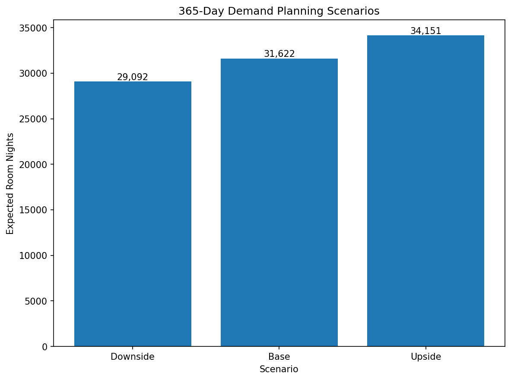

# Forecasting

This note captures what I learned about solving a real-world demand forecasting problem from raw reservation data.

The objective is not to memorize one forecasting solution. It is to understand how to go from an ambiguous business question to a defensible forecasting target, dataset, validation strategy, model, and business recommendation.

---

# 1. Start With the Business Question

A forecasting problem should not begin with:

> Which machine-learning model should I use?

It should begin with:

> What exactly am I trying to predict, and what business decision will use that prediction?

In the case study, the high-level requirement was to forecast demand for the next 365 days separately by booking channel.

But "demand" is ambiguous.

It could mean:

- number of bookings,
- number of reservation lines,
- number of arrivals,
- requested room nights,
- realized room nights,
- occupancy,
- or unconstrained customer demand.

These are not equivalent.

Therefore, defining the forecasting target is one of the most important parts of the problem.

---

# 2. What Is a Room Night?

A **room night** represents one room being occupied for one night.

Suppose a reservation has:

```text
Arrival:   1 July
Departure: 4 July
```

The guest occupies the room on:

```text
1 July
2 July
3 July
```

Therefore:

```text
Length of stay = 3 nights
Room nights    = 3
```

The departure date is not an occupied night.

Mathematically:

```text
Length of Stay = Departure Date - Arrival Date
```

---

# 3. Why Not Simply Forecast Number of Bookings?

Bookings do not represent the amount of inventory consumed.

Consider:

```text
Booking A → 1 room × 1 night = 1 room night
Booking B → 1 room × 10 nights = 10 room nights
```

If I counted only bookings:

```text
Booking A = 1
Booking B = 1
```

They appear equally important.

But Booking B consumes ten times as much accommodation inventory.

For a hospitality demand problem, room nights therefore provide a more useful measure of inventory consumption.

---

# 4. Requested Demand vs Realized Demand

Another important distinction is between:

## Requested room nights

Room nights originally requested through reservations.

This represents booking intent before cancellations.

## Realized room nights

Room nights associated with stays that were actually completed.

This represents accommodation demand that actually materialized.

A cancelled reservation contains useful information about customer intent, but it does not necessarily result in an occupied room.

For the primary forecasting target, I therefore used:

> **Daily realized room nights by booking channel, allocated to the actual calendar dates on which the room inventory was consumed.**

Cancelled reservations were retained for separate cancellation analysis rather than included in the primary realized-demand target.

---

# 5. Transforming Reservations Into Daily Room Nights

Raw reservation data is usually stored at booking or reservation-line level.

That is not directly suitable for daily demand forecasting.

Suppose the raw data contains:

```text
booking_id | arrival    | departure  | channel
-----------|------------|------------|----------
ABC123     | 2024-07-01 | 2024-07-04 | BookingCom
```

For forecasting daily inventory consumption, it should become:

```text
booking_id | stay_date  | channel
-----------|------------|-----------
ABC123     | 2024-07-01 | BookingCom
ABC123     | 2024-07-02 | BookingCom
ABC123     | 2024-07-03 | BookingCom
```

Now every row represents one realized room night.

---

# 6. Python: Expanding Reservations Into Room Nights

The core transformation is:

```python
completed_stays = reservations.loc[
    (reservations["status"] == "CheckedOut")
    & (reservations["length_of_stay"] > 0)
].copy()

completed_stays["stay_date"] = completed_stays.apply(
    lambda row: pd.date_range(
        start=row["arrival_at"],
        end=row["departure_at"] - pd.Timedelta(days=1),
        freq="D"
    ),
    axis=1
)

room_nights = completed_stays.explode(
    "stay_date",
    ignore_index=True
)
```

### What is happening?

`pd.date_range()` creates all occupied dates between arrival and the night before departure.

`explode()` then converts the list of dates into individual rows.

Conceptually:

```text
ONE RESERVATION

Arrival ───────────────────────────── Departure
  │                                      │
  ▼                                      ▼
July 1       July 2       July 3       July 4
  │            │            │            │
  ▼            ▼            ▼            ▼
occupied     occupied     occupied     leave

BECOMES

Reservation
    │
    ├──── July 1 → 1 room night
    ├──── July 2 → 1 room night
    └──── July 3 → 1 room night
```

---

# 7. Always Validate the Transformation

A transformation can run successfully and still be wrong.

Therefore I checked:

```python
expected_room_nights = completed_stays[
    "length_of_stay"
].sum()

actual_room_nights = len(room_nights)

print("Expected:", expected_room_nights)
print("Actual:", actual_room_nights)
print(
    "Transformation valid:",
    expected_room_nights == actual_room_nights
)
```

The logic is:

```text
Sum of original lengths of stay
                =
Number of rows after room-night expansion
```

In the case study:

```text
Expected room nights = 51,696
Expanded rows        = 51,696
Transformation valid = True
```

This is an important data-engineering lesson:

> Never assume a transformation preserved the data correctly just because the code executed without an error.

Always create an invariant or reconciliation check.

---

# 8. Aggregate to Daily Channel Demand

After creating one row per occupied room night, the data can be aggregated:

```python
daily_channel_demand = (
    room_nights
    .groupby(["stay_date", "code"])
    .size()
    .rename("room_nights")
    .reset_index()
)
```

The resulting structure is approximately:

```text
stay_date   | channel        | room_nights
------------|----------------|------------
2024-01-01  | BookingCom     | 48
2024-01-01  | Direct         | 3
2024-01-01  | Ibe            | 21
2024-01-01  | ChannelManager | 10
2024-01-02  | BookingCom     | 51
...

```
This is now a time-series forecasting dataset.

---

# 9. Why Missing Date × Channel Combinations Matter

Suppose no Direct room nights occurred on a particular day.

The raw aggregation may simply contain no row:

```text
2024-01-05 | Direct | <missing>
```

But for demand forecasting, that means:

```text
2024-01-05 | Direct | 0
```

Missing and zero are not the same thing.

Therefore I constructed the complete combination of:

```text
every date × every channel
```

and filled missing combinations with zero.

```python
full_dates = pd.date_range(
    start=room_nights["stay_date"].min(),
    end=room_nights["stay_date"].max(),
    freq="D"
)

full_index = pd.MultiIndex.from_product(
    [full_dates, channels],
    names=["stay_date", "code"]
)

daily_channel_demand = (
    daily_channel_demand
    .set_index(["stay_date", "code"])
    .reindex(full_index, fill_value=0)
    .reset_index()
)
```
This prevents missing observations from accidentally being interpreted as unknown data rather than zero observed demand.

---

# 10. Realized Demand Is Not Necessarily True Market Demand

This was an important conceptual limitation.

Suppose a property has:

```text
100 rooms available
100 rooms sold
20 additional customers wanted rooms
```

Observed realized demand is:

```text
100 room nights
```

But actual market demand may have been:

```text
120 room nights
```

The extra 20 customers cannot appear in completed reservation data because the property had no inventory left to sell.

This is called **censored demand**.

Therefore:

```text
Observed realized demand
        ≠
Unconstrained market demand
```

To estimate unconstrained demand properly, additional information could be

useful, such as:

- searches,
- availability requests,
- rejected bookings,
- sold-out periods,
- competitor demand,
- inventory availability,
- booking pace.

This means the forecast should be described precisely as a forecast of **realized occupied room nights**, not necessarily total latent market demand.

---

# 11. Interview Explanation

### Question

**Why did you forecast room nights instead of bookings?**

### Short answer

Room nights better represent accommodation inventory consumption. A one-night booking and a ten-night booking both count as one booking, but they have very different operational and commercial impact. I therefore expanded completed reservations across their occupied stay dates and forecast daily realized room nights by channel.

### Deeper answer

I first clarified what "demand" should mean for the business problem. Booking counts, arrivals and room nights represent different things. Because the forecast was intended to support accommodation and revenue decisions, I chose realized room nights because they align directly with when inventory is consumed.

I expanded every completed reservation from arrival until the night before departure, validated that the expansion preserved the original total length of stay, and then aggregated the result by stay date and booking channel.

I would also explicitly distinguish this from unconstrained market demand, because realized bookings can be censored when the property is sold out.

---

# 12. Key Lesson

The first important forecasting lesson was:

> **Do not start by choosing a model. Start by defining exactly what the target represents.**

A sophisticated model predicting the wrong business quantity is less useful than a simple model predicting the right one.

---

# 13. Determine the Grain Before Deduplicating

A column called `booking_id` should not automatically be assumed to uniquely identify each row.

During exploration of the reservation dataset:

- 21,112 reservation rows were present.
- There were 20,067 unique `booking_id` values.
- 651 booking IDs appeared more than once.
- Repeated booking IDs were not generally exact duplicate rows.
- Only 32 rows were exact duplicates.
- Repeated booking IDs could differ in booking timestamp, room type, amount, number of persons, status, arrival date, departure date, and other attributes.

One particularly useful example was a Direct booking ID that appeared many times with the same stay dates but different booking timestamps and room types.

This means that blindly applying:

```python
reservations.drop_duplicates("booking_id")
```
would be unsafe.

The important lesson is:

> An ID-looking column is not necessarily the primary key of the dataset.

Before deduplicating, determine the grain of the data:

> What does one row actually represent?

Without a formal data dictionary or a unique room/unit identifier, the exact business meaning of repeated booking IDs cannot be proven from the available fields alone. Therefore, repeated IDs should not be removed simply because the identifier repeats.

---

# 14. Validate at Multiple Levels
A transformation should not be considered correct merely because the code runs.

For the room-night transformation:
```bash
expected_room_nights = completed_stays["length_of_stay"].sum()

actual_room_nights = len(room_nights)
```
The result was:
```txt
Expected room nights: 51,696

Expanded rows:        51,696
```
This is an important mathematical validation, but it does not prove that the source data itself is correct.

A stronger validation process has several layers:
```text
Structural validation
        |
        v
Are columns, dates, statuses and values sensible?


Mathematical validation
        |
        v
Did the transformation preserve the expected totals?


Business validation
        |
        v
Do the resulting patterns make sense in the business context?
```

The general lesson is:

> Correct totals do not automatically imply a correct dataset.

---

# 15. Do Not Confuse Missing History With Zero Demand

The early history showed incomplete temporal coverage.

Reservation-derived daily demand coverage:
```txt
2022-07   11 observed demand dates
2022-08   13 observed demand dates
2022-09   20 observed demand dates
2022-10   31 observed demand dates
2022-11   30 observed demand dates
2022-12   31 observed demand dates
```
Occupancy data showed a similar pattern:
```txt
2022-07    1 observation
2022-08   25 observations
2022-09   25 observations
2022-10   31 observations
2022-11   30 observations
2022-12   31 observations
```

October 1, 2022 was therefore chosen as the start of the usable historical period.

This does not prove that the source system became perfectly complete on that exact date. It is a modelling assumption supported by the fact that both datasets have continuous daily coverage from the first complete calendar month onward.

The important distinction is:
```txt
Missing observation != zero demand
```
A missing date in an incomplete source period should not automatically be filled with zero.

---

# 16. Build a Complete Date x Channel Grid

Once the trusted historical period was selected, every combination of date and active realized-demand channel was constructed.

The four realized-demand channels were:

* BookingCom
* ChannelManager
* Direct
* Ibe

The usable common historical window contained 619 calendar days.

Therefore:
```txt
619 days x 4 channels = 2,476 rows
```

The complete modelling table contained exactly 2,476 rows and no missing values.

Within this accepted observation window, a missing date-channel combination in the derived room-night table is interpreted as zero realized room nights.

Example:
```txt
2022-10-03   BookingCom       33
2022-10-03   ChannelManager    0
2022-10-03   Direct            1
2022-10-03   Ibe              12
```

This is different from filling missing dates in an incomplete historical period with zero.

---

# 17. Explore the Time Series Before Choosing a Forecasting Model

The first visualization should answer a simple question:
>How has realized demand changed over time?



The daily series shows substantial short-term variation, while the 7-day rolling average makes the underlying demand level easier to see.

The rolling average is:
[
MA_7(t) =
\frac{x_t + x_{t-1} + \dots + x_{t-6}}{7}
]

It is used here for visualization, not as a replacement for the original target.

The historical series suggests that the demand-generating process is not perfectly stationary. Demand generally moved to a higher level after the early part of the usable history.

This matters because:

More historical data is not automatically better forecasting data.

Older observations can become less representative when the business or demand process changes.

---

# 18. Weekly Seasonality

Average realized room-night demand by weekday was:

|Day   | Mean Room Nights        |
|------------|----------------|
|Monday|77.39|
|Tuesday|81.49|
|Wednesday|81.41|
|Thursday|79.31|
|Friday|80.69|
|Saturday|82.35|
|Sunday|77.85|



Saturday had the highest average demand, while Monday and Sunday were lower.

However, the difference between the highest and lowest weekday mean was only about five room nights, while the daily standard deviation was generally larger.

Therefore:
> Weekly seasonality exists, but weekday alone does not explain most of the variation in demand.

This means weekday features may be useful, but their value should be tested against simpler forecasting baselines.

---

# 19. Monthly Demand Evolution

Monthly averages reveal both a changing demand level and possible longer-term seasonal effects.

Examples:
```txt
2022-10   65.23
2023-01   69.42
2023-05   84.74
2023-09   87.70
2024-02   86.45
2024-04   87.23
2024-05   85.42
```



Demand increased substantially between late 2022 and 2023 and later remained mostly in the 80s.

There are also possible seasonal movements, such as lower demand during summer 2023 followed by stronger September demand.

However, the dataset contains too few complete annual cycles to confidently claim stable yearly seasonality.

The safer interpretation is:
> The series contains a changing demand level, modest weekly seasonality, and possible longer-term seasonal effects.

---

# 20. Partial Periods Must Be Treated Carefully

June 2024 contains only partial observations in the available data.

A partial month should not be compared directly with complete historical months as though both represented the same amount of observation time.

More importantly, if the forecast is intended to begin on June 1, 2024, using observations from June 1 onward to construct that forecast would introduce look-ahead leakage.

The concepts must therefore remain separate:
```txt
Data availability window
        !=
Forecast training window
        !=
Forecast horizon
```

The forecast origin must be defined explicitly before model evaluation.

---

## 21. Building the Final 365-Day Forecast

After model comparison and rolling-origin backtesting, the final forecasting

strategy used channel-specific recent historical averages.

The selected history windows were:
| Channel | Historical Window |
|---|---:|
| BookingCom | 6 months |
| ChannelManager | 3 months |
| Direct | 1 month |
| Ibe | 3 months |

The forecasting algorithm itself remained deliberately simple:

\[
\hat{y}_{c,t} = \text{mean historical daily room-night demand for channel } c
\]

Only the amount of history used for each channel changed.

This was preferred over adding complexity because previous experiments showed:
- weekday-aware models produced only small and inconsistent improvements;
- linear-trend models substantially worsened forecasting error for several channels;
- different channels responded differently to the amount of historical data used.

The final model therefore favors a simple forecasting rule whose parameters were selected using rolling historical simulations.

---

## 22. Define the Forecast-Time Information Boundary

The final forecast starts on:
```text
2024-06-01
```
and ends on:
```txt
2025-05-31
```

This gives exactly 365 forecast days.

Although the raw reservation-derived demand data extends to 2024-06-11, those June observations cannot be used when constructing a forecast that begins on 2024-06-01.

Using them would introduce look-ahead leakage.

The information boundary is therefore:
```txt
Latest raw demand date:          2024-06-11
Latest allowed historical date: 2024-05-31
Forecast origin:                 2024-06-01
```
A forecasting model should only use information that would genuinely have been
available at the time the forecast was created.

This distinction is important:
```txt
data availability date
        !=
model information cutoff
        !=
forecast horizon
```

---

## 23. Final Historical Windows

At the 2024-06-01 forecast origin, the selected channel models use:
|Channel|History Start|History End|Days|Mean Daily Demand|
|-------|-------------|-----------|----:|-----------------:|
|BookingCom|2023-12-01|2024-05-31|183|49.86|
|ChannelManager|2024-03-01|2024-05-31|92|11.77|
|Direct|2024-05-01|2024-05-31|31|2.06|
|Ibe|2024-03-01|2024-05-31|92|22.93|

Missing date-channel combinations inside the accepted modelling window are represented explicitly as zero realized demand before calculating these means.

This prevents zero-demand days from disappearing from the denominator.

---

## 24. Final Base Forecast

Each selected channel mean is projected across the 365-day forecast horizon.

The resulting base forecast is:
|Channel|Average Daily Room Nights|Annual Room Nights|Share|
|-------|------------------------:|-----------------:|----:|
|BookingCom|49.86|18,200|57.6%|
|ChannelManager|11.77|4,297|13.6%|
|Direct|2.06|754|2.4%|
|Ibe|22.93|8,371|26.5%|
|Total|86.63|31,622|100%|



The base-case forecast is therefore approximately:
**31,622 realized room nights over the next 365 days.**

The forecast also reveals channel concentration.

BookingCom represents approximately 57.6% of forecast room nights, while BookingCom and Ibe together represent roughly 84% of forecast demand.

Channel composition can matter commercially because different distribution channels may have different acquisition costs, commissions, pricing control, and customer relationships.

Those financial effects should not be quantified without supporting data.

---

## 25. Fractional Forecasts Are Expected Values

The model produces values such as:
```txt
BookingCom = 49.86 room nights per day
```

This does not mean that 0.86 of a physical room is sold.

Forecasts represent expected values.

Individual realized room-night counts are integers, while the expected value across possible future outcomes can be fractional.

---

## 26. Channel Error and Aggregate Error Answer Different Questions

Historical channel-level backtesting showed the following approximate error relative to the final daily forecast level:

|Channel|Daily Forecast|Backtest MAE|MAE / Forecast|
|-------|-------------:|-----------:|-------------:|
|BookingCom|49.86|5.69|11.41%|
|ChannelManager|11.77|2.61|22.17%|
|Direct|2.06|3.60|174.38%|
|Ibe|22.93|4.67|20.36%|

The very large percentage for Direct does not mean that future Direct demand will necessarily be wrong by 174%.

Direct has low forecast volume, so even a relatively small absolute error can become extremely large when expressed as a percentage of the forecast level.

This illustrates why percentage-based metrics can become unstable for low-volume series.

There are also two distinct forecasting questions:
```txt
Channel accuracy
    -> Is the channel mix forecast correctly?

Aggregate accuracy
    -> Is total property demand forecast correctly?
```

Errors across channels can partially offset each other at the aggregate level.

Therefore good aggregate accuracy does not automatically imply good
channel-level accuracy.

---

## 27. Historical Aggregate Forecast Error

The selected channel-specific model was simulated at four historical forecast origins.

|Forecast Origin|Predicted Total|Actual Total|Error|Error %|
|---------------|--------------:|-----------:|----:|------:|
|2023-07-01|4,754.81|4,905|-150.19|-3.06%|
|2023-10-01|5,062.01|5,193|-130.99|-2.52%|
|2024-01-01|4,688.50|5,089|-400.50|-7.87%|
|2024-04-01|5,288.24|5,265|+23.24|+0.44%|

Aggregate absolute percentage errors were:
```txt
Mean:    3.47%
Median:  2.79%
Worst:   7.87%
```

Three of the four historical simulations underpredicted total realized demand.

These results show that aggregate forecasts were more stable than some individual channel forecasts because channel-level errors can partially offset one another.

However, only four historical forecast origins were available, so these results should be interpreted as limited historical evidence rather than proof of future performance.

---

## 28. Planning Scenarios

A single point forecast can create a false impression of certainty.

To communicate uncertainty more transparently, three planning scenarios were created.

The worst aggregate absolute percentage error observed in the historical backtests was approximately 7.87%.

This was rounded to 8% and used as a transparent stress assumption around the base forecast.

|Scenario|Multiplier|Annual Room Nights|Average Daily Room Nights|
|--------|----------|-----------------:|------------------------:|
|Downside|0.92|29,092|79.70|
|Base|1.00|31,622|86.63|
|Upside|1.08|34,151|93.57|

The scenario range is therefore approximately:
```txt
29,092  <----  31,622  ---->  34,151
Downside        Base           Upside
```
These values are planning scenarios.



They are not **statistical prediction intervals** or **confidence intervals**.

No probability such as 80%, 90%, or 95% should be attached to this range.

---

## 29. Forecast-Horizon Mismatch

An important limitation remains.

The rolling backtests evaluated approximately two-month forecast horizons, while the final business forecast covers 365 days.

Therefore:
```txt
good two-month backtest performance

            does NOT imply

validated 365-day forecast accuracy
```

The ±8% scenario stress is informed by historical forecast errors, but the historical experiments do not establish that ±8% captures one-year forecast uncertainty.

Long-horizon uncertainty may be substantially larger.

A stronger production forecasting system would ideally evaluate historical forecast origins using horizons closer to the actual business horizon whenever sufficient historical data is available.

---

## 30. Point Forecast, Scenario, and Prediction Interval

These concepts should not be used interchangeably.

### Point Forecast

A model’s central estimate.

Example:
```txt
Expected annual demand = 31,622 room nights
```

### Planning Scenario

A deliberately constructed alternative business outcome.

Example:
```txt
Downside = 29,092
Base     = 31,622
Upside   = 34,151
```

The scenario range can be informed by historical evidence without representing a formal probability distribution.

### Prediction Interval

A statistically calibrated interval intended to contain a future observation with a specified probability under the model assumptions.

For example, a valid 90% prediction interval would require a defensible
uncertainty model and calibration procedure.

The current analysis does not claim such an interval.

---

31. Interview Explanation

A concise explanation of the final forecasting approach:

> I first converted completed reservations into daily realized room nights by booking channel and validated the transformation mathematically. I used temporal validation and rolling-origin backtesting rather than random train-test splits. I established simple baselines, tested different history windows,
weekday seasonality, and linear trends, and retained complexity only when it improved out-of-sample performance. The final model uses channel-specific recent-history windows because different channels showed different levels of stability. At a June 1, 2024 forecast origin, the base model estimates about 31.6 thousand realized room nights over the following 365 days. I also report downside and upside planning scenarios, while explicitly avoiding calling them prediction intervals because the available backtests use much shorter horizons than the final one-year forecast.

---

## 32. Key Lessons From the Final Forecast

* Freeze the information set at the forecast origin.
* Never use observations that occur after the forecast origin.
* Validate forecast shape, missing predictions, and impossible negative values.
* A simple model can be preferable when added complexity does not improve
    out-of-sample performance.
* Different segments can require different historical windows.
* Channel-level and aggregate forecast accuracy answer different business
    questions.
* Low-volume series can make percentage error measures unstable.
* A point forecast should not be presented as certainty.
* Planning scenarios are not prediction intervals.
* Validation horizons should resemble the actual business forecast horizon
    whenever possible.
* Model limitations should be communicated as clearly as model results.
