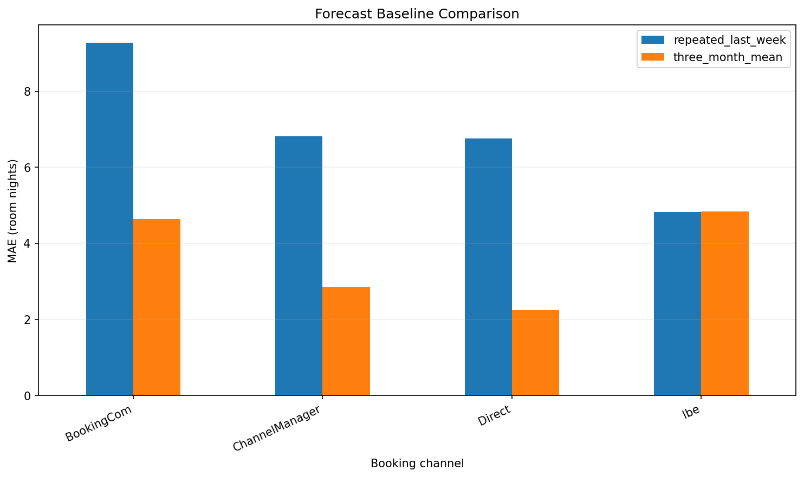
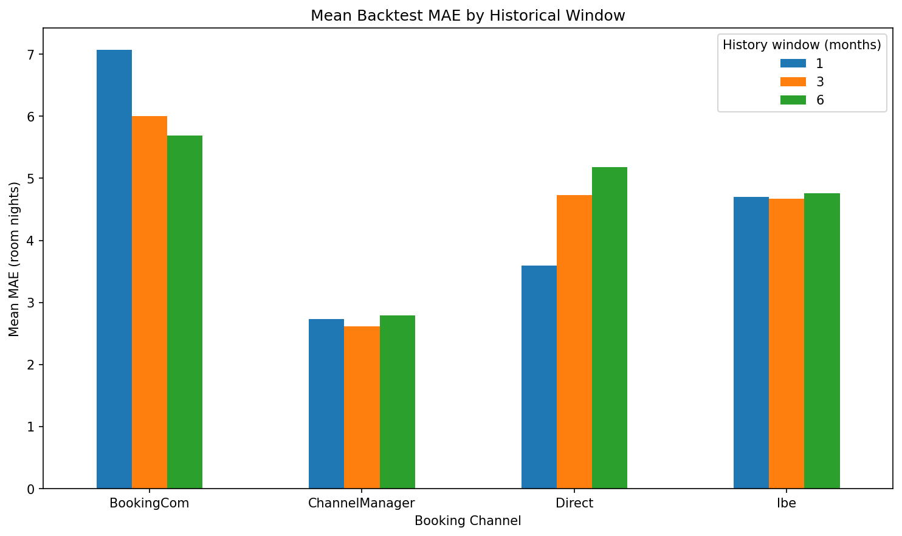
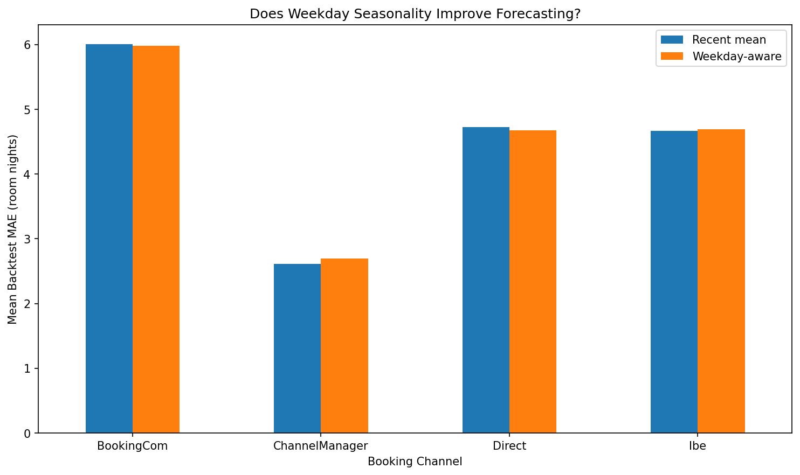
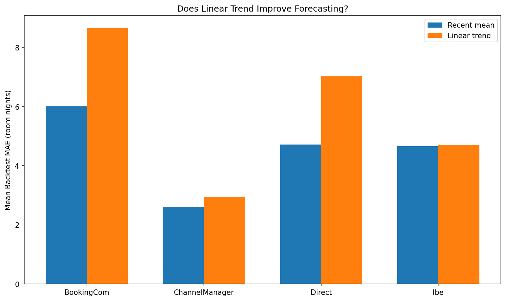

# Establish a Baseline Before Building More Complex Models

Before evaluating more sophisticated forecasting approaches, establish a simple baseline.

A baseline answers an important question:

> Does the proposed forecasting method actually improve on a simple and understandable prediction rule?

Without a baseline, a model can produce an apparently good MAE or RMSE without showing whether the modelling effort provides additional forecasting value.

For this demand-forecasting problem, the evaluation uses a fixed forecast

origin:
```text
Training history                     Validation future
───────────────────────────────────│──────────────────
                                   ↑
                            forecast origin
```
The model may use information available before the forecast origin, but it must not use actual observations from the validation period when constructing the forecast.

---

## Repeated-Last-Week Baseline

One simple baseline assumes that the most recently observed weekly pattern will repeat into the future.

The final seven days of the training period are:
```text
2024-03-25 → 2024-03-31
```

For each channel and weekday, the observed demand from that final week becomes the forecast pattern.

Conceptually:
```text
Last observed week
Monday    → Monday forecast
Tuesday   → Tuesday forecast
Wednesday → Wednesday forecast
...
Sunday    → Sunday forecast
```

That seven-day pattern is then repeated throughout the complete validation horizon:

```text
Mar 25 ───── Mar 31 │ Apr 1 ───────────────── May 31
 last observed week │
        ↓           │
 Mon Tue ... Sun    │ Mon Tue ... Sun Mon Tue ... Sun ...
                    │
                    └── repeated weekly pattern
```

This is a **fixed-origin repeated-last-week baseline**.

It is important not to confuse it with a rolling seven-day lag such as:

```python
prediction[t] = actual[t - 7]
```

A rolling lag would begin using actual validation observations once the validation period had started.

For a fixed-origin multi-step forecast, those future observations would not have been known when the forecast was created.

Therefore, the repeated-last-week baseline preserves the information boundary at the forecast origin.

---

## Baseline Performance

For the validation period:
```text
2024-04-01 → 2024-05-31
```

the repeated-last-week baseline produced:
| Channel | MAE | RMSE |
|---|---:|---:|
| BookingCom | 9.28 | 11.68 |
| ChannelManager | 6.82 | 8.12 |
| Direct | 6.75 | 7.43 |
| Ibe | 4.82 | 5.81 |

MAE measures the average absolute forecast error in the original target unit:

```text
room nights
```

For example:
```text
BookingCom MAE = 9.28
```

means the forecast was wrong by approximately 9.28 BookingCom room nights per

day on average during the validation period.

RMSE gives greater weight to large errors because the individual errors are

squared before averaging.

Therefore:

```text
MAE
→ typical magnitude of the error

RMSE
→ more sensitive to unusually large misses
```

---

## Error Must Be Interpreted Relative to Demand Scale

Raw MAE should not be compared across channels without considering their demand levels.

During validation:
| Channel | Mean Actual Demand | MAE |
|---|---:|---:|
| BookingCom | 49.51 | 9.28 |
| ChannelManager | 11.26 | 6.82 |
| Direct | 1.85 | 6.75 |
| Ibe | 23.69 | 4.82 |

The same numerical error can have very different business meaning depending on the scale of the channel.

For context, the ratio:
```text
MAE / mean(actual)
```

was approximately:
| Channel | MAE as % of Mean Demand |
|---|---:|
| BookingCom | 18.74% |
| ChannelManager | 60.55% |
| Direct | 364.60% |
| Ibe | 20.35% |

This quantity is useful as a scale comparison, but it is **not MAPE**.

MAPE calculates the percentage error separately for every observation:

```text
mean(
    absolute_error / actual
)
```

whereas the calculation above is:
```text
mean_absolute_error / mean_actual
```

The distinction is especially important for channels such as Direct where actual demand can be very small or zero. Traditional MAPE can become unstable or undefined when actual values approach zero.

---

## Recent-Mean Baseline

A second simple strategy predicts demand using the average daily room-night level from the most recent three months of training history.

For the forecast origin:

```text
2024-04-01
```

the model uses:
```text
2024-01-01 → 2024-03-31
```
and calculates one average for each channel.

The resulting predictions were approximately:
| Channel | Daily Prediction |
|---|---:|
| BookingCom | 49.23 |
| ChannelManager | 10.33 |
| Direct | 3.91 |
| Ibe | 21.77 |

These predictions remain fixed throughout the two-month validation horizon.

The validation performance was:
| Channel | MAE | RMSE |
|---|---:|---:|
| BookingCom | 4.64 | 5.83 |
| ChannelManager | 2.85 | 3.72 |
| Direct | 2.24 | 2.46 |
| Ibe | 4.84 | 5.81 |

Compared with the repeated-last-week baseline:

| Channel | Repeated Last Week MAE | Three-Month Mean MAE |
|---|---:|---:|
| BookingCom | 9.28 | **4.64** |
| ChannelManager | 6.82 | **2.85** |
| Direct | 6.75 | **2.24** |
| Ibe | **4.82** | 4.84 |



For BookingCom, ChannelManager, and Direct, the recent-mean strategy clearly outperformed repeating one particular week.

For Ibe, the two approaches performed almost identically.

---

## Why Can a Simple Mean Beat the Last Week?

The repeated-last-week baseline assumes that the final observed week contains a useful pattern that will persist throughout the forecast horizon.

But one week can contain temporary noise.

For example, Direct demand during the final training week was substantially higher than its average demand during the later validation period.

Repeating that unusually high week for another two months therefore produced large errors.

The three-month mean smooths short-term fluctuations:

```text
one week
→ responsive
→ but potentially noisy

three months
→ smoother estimate of recent demand level
→ less affected by one unusual week
```

This does not prove that a three-month mean is universally the best forecasting model.

It only shows that, for this particular validation period, recent demand level was more informative than repeating the final observed week.

That observation motivates the next question:

> Does the three-month mean remain strong at other points in time?

Answering that question requires rolling-origin backtesting.

---

## Baseline Selection Is Part of Model Evaluation

A baseline should be:

- simple enough to understand,
- difficult to accidentally leak future information into,
- reproducible,
- appropriate for the forecasting horizon,
- and meaningful enough that a more complicated model should be expected to beat it.

The goal is not to build a deliberately weak benchmark.

The goal is to establish a credible minimum level of performance.

A useful interview explanation is:

> "I started with simple fixed-origin baselines before considering more complex models. Repeating the final observed weekly pattern gave a clear seasonal benchmark, while a recent-mean baseline tested whether the current demand level was more informative than one particular week. The recent mean substantially improved MAE for three channels, which suggested that recent level was more important than short-term weekly variation. I then used rolling-origin backtesting to test whether that conclusion remained stable across different historical periods."


 ---

# Rolling-Origin Backtesting

A single train-validation split is useful, but it can give a misleading impression of forecast quality.

A model may perform well during one validation period simply because that period happens to match the assumptions of the model.

For time-series forecasting, a stronger evaluation approach is **rolling-origin backtesting**.

The idea is to simulate multiple historical forecasting decisions.

For example:

```text
Historical simulation 1
Apr 2023 ───────── Jun 2023 │ Jul 2023 ───── Aug 2023
         history            │      future
                            ↑
                     forecast origin


Historical simulation 2
Jul 2023 ───────── Sep 2023 │ Oct 2023 ───── Nov 2023
         history            │      future
                            ↑
                     forecast origin
```

At every forecast origin:

1. Only information available before the origin is used.
2. A forecast is generated.
3. The forecast is compared with the future that actually occurred.
4. The same forecasting procedure is repeated at another historical origin.

This provides evidence about whether a forecasting strategy is stable across different periods rather than successful on only one holdout period.

---

## Forecast Origins Used

Four historical forecast origins were evaluated:
|Forecast Origin|Evaluation Period|Evaluation Days|
|---------------|-----------------|---------------|
|2023-07-01|2023-07-01 to 2023-08-31|62|
|2023-10-01|2023-10-01 to 2023-11-30|61|
|2024-01-01|2024-01-01 to 2024-02-29|60|
|2024-04-01|2024-04-01 to 2024-05-31|61|

The evaluation windows use calendar-aware date offsets.

This matters because calendar months have different numbers of days and February 2024 contains 29 days.

---

## Why Random Train-Test Splits Are Wrong Here

A random train-test split can allow observations from the future to influence a model that is evaluated on observations from the past.

That does not represent how forecasting works in production.

At a forecast origin such as:
```txt
2024-01-01
```

the model may use:
```txt
past information ≤ 2023-12-31
```

but it must not use:
```txt
future information ≥ 2024-01-01
```

This separation prevents look-ahead leakage.

The evaluation should reproduce the information boundary that would have existed when the forecast was actually made.

---

## Fixed-Origin Multi-Step Forecasting

The backtests use a fixed forecast origin.

For example, at:
```txt
forecast origin = 2023-07-01
```

a three-month recent-mean model calculates its prediction using:
```txt
2023-04-01 → 2023-06-30
```

and then forecasts the complete:
```txt
2023-07-01 → 2023-08-31
```
evaluation horizon.

The model does not update itself using actual July observations while forecasting August.

This is different from a rolling one-step forecast in which newly observed values become available after every prediction.

The distinction is important because the evaluation procedure should match the real forecasting decision being simulated.

---

## Validate Coverage Before Calculating Metrics

Backtesting is only trustworthy when both the historical and evaluation windows contain the expected observations.

For each forecast origin, the pipeline checks:
```txt
expected calendar days
        versus
observed days per channel
```

If the values do not match, the evaluation stops with an error rather than silently calculating potentially misleading metrics.

This is an example of failing loudly.

A forecasting pipeline should prefer:
```txt
invalid data
    ↓
STOP
    ↓
investigate
```

over:
```txt
invalid data
    ↓
calculate metrics anyway
    ↓
trust incorrect result
```

---

## Missing Date × Channel Combinations

During validation, the Direct channel was found to contain only 90 observations
in the 92-day history preceding the 2024-01-01 forecast origin.

The missing combinations were:
```txt
2023-12-15 × Direct
2023-12-17 × Direct
```

The same calendar dates contained realized demand for the other channels.

After aggregation, a channel with no realized room nights on a date can disappear completely from a sparse date × channel table.

Within the accepted modelling period, this should be represented as:
|date|        channel|    room_nights|
|----|---------------|---------------|
|2023-12-15|  Direct|     0|
|2023-12-17|  Direct|     0|

rather than removing those dates from the channel’s historical average.

A complete grid is therefore constructed from:
```txt
all modelling dates
        ×
all modelled channels
```

and missing combinations are filled with zero realized room nights.

This rule applies only inside the accepted modelling period where calendar coverage has already been established. Missing observations during periods with incomplete source coverage should not automatically be interpreted as
zero demand.

---

## Three-Month Recent-Mean Backtest

The first forecasting strategy uses the average realized daily room-night
demand from the previous three calendar months.

For each channel:
```txt
prediction =
mean(daily room nights during previous 3 months)
```

The same channel-level prediction is then applied across the following two-month evaluation horizon.

The rolling-origin MAE results were:
|Forecast Origin|BookingCom|ChannelManager|Direct|Ibe|
|---------------|----------|--------------|------|---|
|2023-07-01|6.94|2.15|2.67|3.90|
|2023-10-01|6.43|2.04|7.42|4.79|
|2024-01-01|6.02|3.40|6.58|5.12|
|2024-04-01|4.64|2.85|2.24|4.84|

The Direct channel demonstrates why a single validation period can be
misleading.

At the final origin its MAE is only:
```txt
2.24 room nights
```

but earlier historical simulations produced:
```txt
7.42

6.58
```

Therefore, strong performance on the final validation period alone would overstate the stability of this forecasting strategy.

---

## Choosing the Historical Window

The amount of historical information used by a recent-mean model is a hyperparameter.

Short windows respond quickly to recent changes but may be noisy.

Long windows are more stable but may contain stale information when demand levels change.

The following history windows were compared:
```txt
1 month
3 months
6 months
```

A 12-month window was not included in this comparison because the earliest forecast origin does not have 12 months of history inside the accepted modelling period.

The rolling-backtest summary was:
|History|Channel|Mean MAE|Median MAE|Worst MAE|
|-------|-------|--------|----------|---------|
|1 month|BookingCom|7.07|6.24|10.75|
|3 months|BookingCom|6.01|6.22|6.94|
|6 months|BookingCom|5.69|5.60|6.89|
|1 month|ChannelManager|2.73|2.73|3.27|
|3 months|ChannelManager|2.61|2.50|3.40|
|6 months|ChannelManager|2.79|2.75|3.61|
|1 month|Direct|3.60|2.92|7.41|
|3 months|Direct|4.73|4.62|7.42|
|6 months|Direct|5.18|4.90|7.64|
|1 month|Ibe|4.70|4.74|4.94|
|3 months|Ibe|4.67|4.82|5.12|
|6 months|Ibe|4.76|4.84|5.67|



---

# Interpretation

The results show that there is no universally optimal history length.

**BookingCom** benefits from the six-month window. Its mean MAE decreases from
7.07 with one month to 5.69 with six months, and the six-month window also has
the strongest median and worst-case performance.

**ChannelManager** performs best on average with three months of history,
although the differences between the windows are relatively small.

**Direct** behaves differently. The one-month window performs substantially
better than longer windows. This suggests that older Direct demand can become
stale relatively quickly and that the channel may experience stronger changes
in its demand level.

**Ibe** is relatively insensitive to the selected window. Mean MAE ranges only
from 4.67 to 4.76, so the available evidence does not support a strong claim
that one window is fundamentally superior.

Because only four forecast origins are available, these results should be
treated as evidence about forecast stability rather than proof of universally
optimal hyperparameters.

---

# Key Interview Lesson

A strong forecasting answer should not be:

> “I tried several models and selected the one with the lowest validation MAE.”

A stronger answer is:

> “I defined a realistic forecast origin, prevented look-ahead leakage, built
simple baselines, and evaluated candidate strategies using rolling-origin
backtesting. I compared average, median, and worst-case errors across
historical periods because a single validation window can make an unstable
model look strong. I also validated date-channel coverage before scoring so
missing zero-demand observations could not bias the evaluation.”

The central lesson is:

**Model selection for time series should evaluate performance across time, not
only performance on one split.**

---

## Testing Whether Weekday Seasonality Improves Forecasting

Exploratory analysis showed differences in average realized room-night demand across weekdays.

For example, total historical demand tended to be lower on Monday and Sunday and higher on Tuesday, Wednesday, and Saturday.

However, observing a historical pattern does not prove that the pattern is useful for forecasting.

This leads to an important distinction:
```text
descriptive pattern
        ≠
predictive signal
```

Instead of automatically adding weekday information to the forecasting model, weekday seasonality was treated as a hypothesis that needed to be validated out of sample.

---

## Recent-Mean Baseline vs Weekday-Aware Model

The existing recent-mean model learns one value for each channel:

```text
channel
    ↓
mean demand during recent history
    ↓
same prediction for every future day
```

The weekday-aware model learns a separate historical mean for every:
```text
channel × weekday
```

For example:
```text
BookingCom × Monday
BookingCom × Tuesday
...
BookingCom × Sunday
Direct × Monday
Direct × Tuesday
...
```

With four channels and seven weekdays, the model can learn up to:
```text
4 × 7 = 28
```
different demand levels.

The hypothesis was:
> If weekday effects are stable and predictive, channel × weekday averages should outperform a simple channel-level recent mean.

---

## Keep the Experiment Fair

Both models use:

```text
same target
same modelling data
same forecast origins
same historical window
same evaluation horizon
same error metric
```

Only the forecasting assumption changes.

For this experiment:
```text
Historical window = 3 months
Forecast horizon   = 2 months
```

The four forecast origins were:
```text
2023-07-01
2023-10-01
2024-01-01
2024-04-01
```

This controlled comparison makes it possible to attribute differences in performance to the weekday feature rather than to changes in the data or evaluation procedure.

---


## Rolling-Backtest Results

Mean MAE across the four forecast origins:
| Channel | Recent Mean | Weekday-Aware | Relative Change | Weekday Wins |
|---|---:|---:|---:|---:|
| BookingCom | 6.01 | 5.98 | -0.39% | 3 / 4 |
| ChannelManager | **2.61** | 2.70 | +3.40% | 1 / 4 |
| Direct | 4.73 | 4.67 | -1.14% | 3 / 4 |
| Ibe | **4.67** | 4.69 | +0.57% | 2 / 4 |

A negative relative change means the weekday model reduced MAE.

A positive relative change means it increased MAE.



---

## Why Win Count Alone Is Not Enough

The weekday model beat the recent-mean baseline in several individual backtests.

For example:
```text
BookingCom → weekday wins 3 of 4 origins
Direct     → weekday wins 3 of 4 origins
```

That might initially appear to support the weekday model.

However, the magnitude of improvement was very small.

Across origins:
```text
BookingCom improvement ≈ 0.39%
Direct improvement     ≈ 1.14%
```

Meanwhile, ChannelManager became approximately:
```text
3.40% worse
```

Therefore, model selection should not simply count how often one model beats another.

The size and consistency of the improvement also matter.

---

## Bias-Variance Intuition

A three-month historical window contains roughly:
```text
~91 daily observations per channel
```

The simple recent-mean model can use approximately all of those observations to estimate one channel-level demand value.

After splitting by weekday:
```text
91 / 7 ≈ 13
```
observations may remain for each channel × weekday estimate.

Conceptually:
```text
RECENT MEAN

~91 observations
      ↓
one estimate
      ↓
less specific
more stable


WEEKDAY-AAWARE MEAN

~13 observations
per weekday
      ↓
seven estimates
      ↓
more specific
potentially noisier
```

The weekday model has greater flexibility, but that flexibility does not automatically translate into better predictions.

This is an example of the bias-variance trade-off.

---

## Model Decision

The weekday-aware model should not replace the simpler recent-mean baseline based on the available evidence.

The reasons are:
1. Improvements for BookingCom and Direct are small.
2. ChannelManager becomes meaningfully worse.
3. Ibe is effectively unchanged.
4. Additional model complexity does not produce consistent out-of-sample improvement.
5. Only four historical forecast origins are available, so small differences should not be overinterpreted.

The preferred principle is:
> Add complexity only when it provides meaningful and repeatable out-of-sample value.

This does not mean weekday effects do not exist.

It means the available evidence does not show that modelling them explicitly provides enough forecasting value to justify the additional complexity.

---

## Interview Explanation

A concise interview explanation is:
> "EDA showed weekday differences, but I treated that as a modelling hypothesis rather than assuming seasonality would improve the forecast. I compared channel-specific weekday means against the recent-mean baseline using identical rolling-origin backtests. Weekday modelling improved mean MAE by less than 1.2% for the channels that benefited, while ChannelManager deteriorated by about 3.4%. I therefore retained the simpler baseline because the additional temporal structure did not provide consistent out-of-sample value."

The broader lesson is:

**Patterns discovered during EDA should be validated for predictive value before being incorporated into a forecasting model.**

---

## Testing Whether Linear Trend Improves Forecasting

### Hypothesis

Exploratory analysis can show that demand levels move over time.

A natural hypothesis is therefore:

> If recent demand is increasing or decreasing, extrapolating that movement may improve the forecast.

To test this hypothesis, I compared the existing recent-mean baseline with a channel-level linear-trend model.

The comparison used the same:
- target: daily realized room-night demand by channel
- historical window: 3 months
- forecast horizon: 2 months
- forecast origins
- rolling-origin evaluation framework
- MAE metric

This isolates the effect of adding trend.

### Linear Trend Model

For each booking channel, the model fits:

\[
\hat{y}_t = a + bt
\]

where:
- \(a\) is the intercept
- \(b\) is the estimated daily trend
- \(t\) represents time

The fitted trend is then extrapolated into the evaluation period.

### Rolling Backtest Results

| Channel | Recent Mean MAE | Trend MAE | Relative Change |
|---|---:|---:|---:|
| BookingCom | 6.01 | 8.65 | +43.95% |
| ChannelManager | 2.61 | 2.96 | +13.24% |
| Direct | 4.73 | 7.02 | +48.59% |
| Ibe | 4.67 | 4.71 | +0.86% |

Positive relative change means the trend model produced higher error.



### Why the Trend Model Failed

The estimated trends were not stable across forecast origins.

For example, Direct's estimated change per 30 days moved approximately:
```text
2023-07-01    -0.37
2023-10-01    +0.39
2024-01-01    -7.71
2024-04-01    +1.41
```
The model therefore interpreted temporary movements as persistent trends.

At the `2024-01-01` forecast origin, **Direct’s** fitted trend produced negative future room-night predictions, including a final prediction of approximately **-17** room nights.

Negative demand is not physically meaningful.

A non-negativity constraint could prevent invalid predictions, but it would not solve the more fundamental problem: the estimated trend itself was unstable.

---

## Win Count Is Not Enough

The Direct trend model beat the baseline in 2 of the 4 forecast origins.

However, its average MAE increased from **4.73** to **7.02**, approximately **48.6%**.

This demonstrates why model selection should not rely only on how often a model wins.

The magnitude and stability of errors also matter.

---

## Model Decision

The linear-trend model is rejected.

It adds complexity but does not provide consistent out-of-sample improvement over the recent-mean baseline.

The recent-mean model remains the stronger baseline because it is:
* simpler
* more stable
* easier to explain
* less sensitive to temporary changes
* better on average across the rolling backtests

---

## Interview Lesson

A trend visible in recent historical data should not automatically be extrapolated.

> I tested whether recent linear movement contained useful predictive information using rolling-origin backtesting. The trend model produced unstable slopes, occasionally generated impossible negative demand, and increased average MAE for every channel.

Therefore, I retained the simpler recent-mean approach.

The broader lesson is:
>A model should earn additional complexity through stable out-of-sample improvement, not through a better-looking fit to historical data.